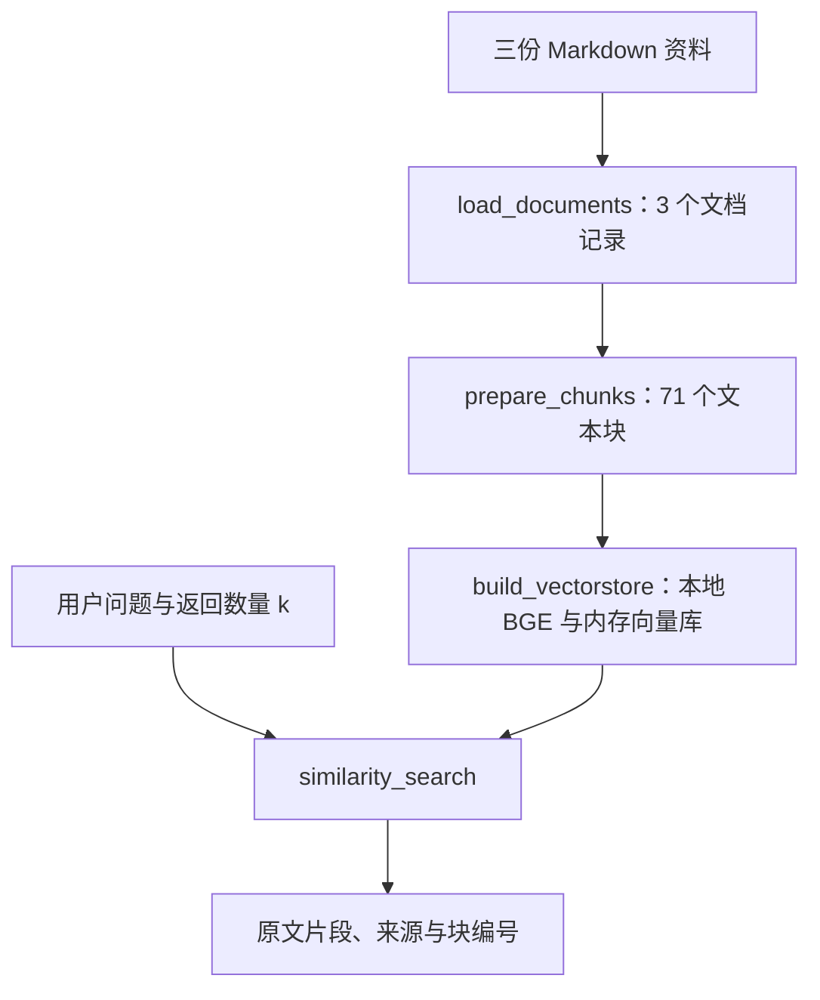

# Evidence RAG（建设中）

目标：围绕一组相关资料，逐步完成带原文引用、混合检索、有限检索反馈及实际评估的问答系统。当前从 all-in-rag 选例持续迭代，已验证多文件加载与切分，尚不是完整 RAG 成品。

## 当前范围

- 已写：三份原教程资料的目录加载、文档列表汇总、来源和正文预览、空目录报错。
- 已验证：Python AST、资料 blob 一致性；2026-10-24 用户实际运行加载入口成功，共 3 份文档，正文分别为 7787、11303、6010 字符。
- 已验证：2026-10-24 用户运行 chunk_size=500/chunk_overlap=100 的切分入口成功，3 文档共 71 块；数据加载 21 块、文本切分 32 块、向量嵌入 18 块。前 3 块为 C001/C002/C003，来源均为第一篇，长度为 317/226/453 字符。
- 已验证：2026-10-24 用户运行 BGE 本地缓存模型/内存向量库的 Dense 检索，3 文档/71 块，重叠问题的 Top-3 为 C030、C022、C051，来源均是文本切分教程。流程成功不等于证据充分，人工核对详见 evals/baseline_observations.json。
- 后续计划：可核对引用、Hybrid、小评估、有预算的检索反馈。未完成项不作为现有能力或指标。
- Day 9 已验证：用户已安装 jieba 0.42.1 / rank-bm25 0.2.2，并实际运行中文问题分词。原问题按空格拆为1项，中文分词/清理后为6项：文本、切分、为什么、要、设置、重叠。
- Day 9 已验证：BM25索引/Top-3与同一意图换问法实验，两个问法均由第2名C029提供重叠作用依据；结果与局限见下节，不推广为整体检索提升。
- Day 10 两路候选与合并入口已由用户运行验证：Dense C030/C022/C051，BM25 C052/C029/C020，6条按编号去重后仍6块。重复编号路径仅人工语料离线检查；融合排序尚未实现，不称完整混合检索已完成。
- Day 10 用户已实际运行等权RRF评分/排序：每路3、最终3，完整排名C030/C052/C022/C029/C051/C020，最终未保留直接依据C029。它与C022同分，按首次出现顺序排第4。流程跑通但本例证据覆盖相对BM25前三退化，不能声称融合提升质量。
- Day 10 扩大候选实验已有用户运行：每路6/最终3，12条去重为11块，共同命中C027（两路均第6），累计0.03030303后升融合第1，最终C027/C030/C052含直接解释。仅确认此例恢复依据，默认仍每路3，未测整体质量/延迟。

## 当前已验证的数据流



每个节点均对应当前代码和用户运行记录。后续生成回答、混合检索与反馈流程分别验证后再加入图中；内存索引当前每次重建。模块设计与效果取舍通过实际问题对照记录，不只展示技术名词。

## 成品目标与验收（计划，尚未实现）

- 一组相关文档覆盖术语、跨片段/跨文档与无答案问题，结果能追溯文件和块；三篇教程只是起步。
- 在同一组问题上对比 Dense、BM25、Hybrid，保留命中/遗漏和实际测量，不预设混合检索必然提升。
- 回答附原文引用、资料不足明确说明；程序编号检查与内容支撑评估区分。
- 选取一条有界反馈：资料质检不足时改写再检索，有重试上限与耗尽后的不足/失败结果，并保留与无反馈基线的对照。
- 先约 15～20 个有预期依据的回归问题，覆盖正常/漏检/无答案，记录检索、引用、延迟与失败；这只是初始样本，不声称普遍准确率。
- 索引构建与问答职责清楚，可复用或按文档重建；有接口/可复现入口、配置示例、日志、README 和自己的改动说明。

### 自我反思的具体范围（计划，尚未实现）

本轮所说的自我反思，是一个受控的检索检查与修正流程：检索 → 判断资料是否相关/充分 → 不足时改写问题再检索 → 达到次数上限仍不足时明确说明。不能只增加“反思”提示词就视为该模块完成。

验收需保留同组问题下有/无反馈的实际对照，记录改善、未改善或退化、增加的耗时/模型调用和停止路径；同时能够结合代码解释、修改和排错，区分参考代码与自己的改动。当前三篇资料加载是第一阶段，反馈流程、混合检索、完整评估和工程交付均待完成。

## 今天运行

复用当前学习机器已有的 Day 5 环境，不需重新安装：

```powershell
cd D:\tt\agent
.\day05-basic-rag\.venv\Scripts\python.exe -X utf8 .\projects\evidence-rag\inspect_documents.py
```

预期加载 3 份文档，显示数据加载、文本切分和向量嵌入各自的文件名、正文长度、前 100 字符。实际运行是否成功，以用户输出为准。此入口不读密钥、不加载模型权重、不发模型请求。

第二阶段切分观察，由用户执行：

```powershell
cd D:\tt\agent
.\day05-basic-rag\.venv\Scripts\python.exe -X utf8 .\projects\evidence-rag\inspect_chunks.py
```

预期仍有 3 份完整文档，生成多个文本块，并显示各文件块数和前 3 块的编号/来源。具体块数以实际运行输出为准；500/100 是本项目实验基线，不声称优于旧示例或是最优参数。块编号仅对应当前语料和切分配置，资料或参数变化后需重新核对。

## 第三阶段：向量检索（用户运行已验证）

复用当前已有模型缓存和环境：

```powershell
cd D:\tt\agent
.\day05-basic-rag\.venv\Scripts\python.exe -X utf8 .\projects\evidence-rag\retrieve.py
```

默认问题“文本切分为什么要设置重叠？”，--k 默认 3；两个参数都可以在命令末尾更换。预期从 71 块中返回最多 3 个带编号和来源的原文片段，具体排序/能否提供依据以用户实际输出为准。问题和文本块均由嵌入模型编码；返回的结果为正文与 metadata，不是向量。

此入口在本机计算嵌入，使用内存索引，退出后不持久保存；每次运行重建。它不读取密钥、不调用生成模型，也不把相似度排名当成答案正确性评估。

### 第一个真实基线观察

问题“文本切分为什么要设置重叠？”的 Top-3 命中了相关文件，但完整 C030/C022/C051 主要是示例代码/边界问题、模型长度限制和句子窗口，未直接取回原文“通过重叠机制保持上下文连续性”的说明。记录为部分相关、直接证据覆盖不足，不能视为完全无关或整体检索评估通过。

原始配置、用户返回编号与人工判断见 [baseline_observations.json](evals/baseline_observations.json)。2026-10-24 用户保持其他条件不变运行 --k=6，返回 C030/C022/C051/C037/C035/C027；人工只读核对 C027 完整正文，发现其中确有重叠保持上下文连续性的直接说明，该句位于前 300 字符预览之后。

本例扩大返回范围补回了依据，但依据仍排第 6，前三名未改变，不能视作排序改善。返回原文合计从 1145 增至 2384 字符，未测延迟或生成 token；不将一个例子推广为普遍改进。默认 k=3 保留作基线，本次只通过命令参数设为 6。

```powershell
cd D:\tt\agent
.\day05-basic-rag\.venv\Scripts\python.exe -X utf8 .\projects\evidence-rag\retrieve.py --k 6
```

## Day 9 第一阶段：中文分词（用户运行已验证）

为后续关键词匹配准备一致的词项列表。初版只比较按空格拆分与中文分词；当前 bm25_retrieve.py 默认已扩展为检索，若只回看分词请加 --inspect-only。原71块、Dense默认k及已有基线记录不变。

在已有学习环境增加 rank-bm25（评分工具）和 jieba（中文分词工具），不新建环境，也不下载 BGE/生成模型：

```powershell
cd D:\tt\agent
.\day05-basic-rag\.venv\Scripts\python.exe -m pip install -r .\projects\evidence-rag\requirements-bm25.txt
.\day05-basic-rag\.venv\Scripts\python.exe -X utf8 .\projects\evidence-rag\bm25_retrieve.py --inspect-only
```

预期看到原问题、按空格拆分列表与中文词列表，实际切词以用户运行输出为准；此阶段没有BM25排名，不把切词成功等同检索改善。问题/文本块后续会使用同一个 tokenize 函数，返回检索结果仍是原文块。

已有 AST、模拟切词清理逻辑检查，以及上述用户真实安装/分词输出。完整BM25检索的实际证据见下节，分词成功本身不等于检索效果已验证。

## Day 9 第二阶段：BM25 检索（用户运行已验证）

```powershell
cd D:\tt\agent
.\day05-basic-rag\.venv\Scripts\python.exe -X utf8 .\projects\evidence-rag\bm25_retrieve.py
```

from_documents 接收71个Document并保留正文/metadata，调用 tokenize 处理各块正文建立词统计；invoke接收原始问题，内部再按同一规则处理，返回默认3个Document。主程序提前打印问题词列表用于观察，不将该列表当作invoke的输入。

为方便核对证据，BM25入口展示返回块的完整正文。2026-10-27用户在同三份资料、71块、500/100、原问题、k=3下实际返回C052/C029/C020（427/243/437字符）。C029的代码注释明确说明块间重叠“以缓解语义割裂”，所以本例前三块取回了直接依据；C052主要是工具介绍，C020主要是PDF解析，仍混有未直接回答问题的结果。

同一问题的Dense前三块未直接覆盖重叠作用，BM25此次取回了另一块C029中的依据；这不是将Dense第6名C027提升到前三，也不能推出BM25在其他问题上更好。返回正文共1107字符，未测查询耗时、生成token或整体准确率，未调用生成模型。配置与人工判断见 [bm25_observations.json](evals/bm25_observations.json)。

只将问题改为“chunk_overlap 有什么作用？”后，用户实际得到C034/C029/C036，C029仍排第2；三块都含参数用法，不等于三块都解释作用。实际问题词为chunk/overlap/有/什么/作用，jieba会拆开标识符，当前预处理不保证保留整个参数名。保持资料/问题规则一致，本次未改变分词行为。

即使问题词没有匹配，该库的get_top_n也可能返回k条零分候选；当前不把返回条数或排名当充分依据，需原文核对。该限制由独立模拟语料验证，不作为课程案例效果结论。

## Day 10：两路候选与合并去重

用户已实际运行两路候选入口并核对完整原文，结果见 [hybrid_observations.json](evals/hybrid_observations.json)。当前新增合并去重阶段，仍不输出融合排名或调用生成模型。沿用当前已安装依赖与嵌入缓存，无需重新安装。

```powershell
cd D:\tt\agent
.\day05-basic-rag\.venv\Scripts\python.exe -X utf8 .\projects\evidence-rag\hybrid_retrieve.py
```

--candidate-k默认3，控制每路各返回几块。两路使用同一批带编号Document，结果分别保存到dense_docs/bm25_docs。merge_candidates按metadata.chunk_id去重，完整Document放进merged_docs，编号另存seen_ids检查重复；首次出现顺序不是融合排名。用户实际运行合并段得到6→6，编号顺序为C030/C022/C051/C052/C029/C020；本次没有重复候选，重复路径仅用独立人工语料检查。两路仍分开保留，供后续使用各自排名进行融合。

等权RRF评分与排序已由用户实际运行：分数由两路原始排名累计，降序排序；同分使用Python稳定排序保留合并时的首次出现顺序，即本基线Dense优先。--k默认3控制最终块数，候选不足时返回实际可用数量。所有最终结果仍是含正文与metadata的Document，不是分数或编号列表。

基线每路3个候选无共同编号，RRF同名次同分，C029与C022均0.01612903，固定同分顺序将直接依据C029排到第4。最终C030/C052/C022共1330正文字符，没有直接解释重叠作用；不能视为融合效果提升。详细用户运行记录见evals/hybrid_observations.json。后续仅扩大每路候选至6、最终仍3的真实实验见下节，未为保留已知答案私改分数或同分规则。

### 候选数对照（用户实际运行）

| 每路候选数 | 最终块数 | 去重 | 最终编号 | 直接依据 |
| --- | --- | --- | --- | --- |
| 3 | 3 | 6→6 | C030/C052/C022 | 未保留 |
| 6 | 3 | 12→11 | C027/C030/C052 | C027说明重叠保持上下文连续性 |

第二次仅扩大每路候选、最终仍3，其他问题/语料/配置/融合规则不变。C027在两路均第6，分数1/66+1/66≈0.03030303；正文仅保留一份，两路贡献均计入，最终排第1。最终正文1337字符，C029仍未入选，恢复依据来自C027。单例不证明一般效果、参数最优或三个最终块都相关；没有测延迟/生成token，默认每路3保留作失败基线。原始输出见 [候选6实验日志](evals/runs/2026-10-28-candidate6-k3.txt)。

```powershell
.\day05-basic-rag\.venv\Scripts\python.exe -X utf8 .\projects\evidence-rag\hybrid_retrieve.py --candidate-k 6 --k 3
```

## Day 11：评估题读取与核对函数

evals/retrieval_cases.json先准备3道开发题与原文依据，助手对照资料编写、逐条确认quote存在；备选不保证穷尽，也不是独立测试集。eval_retrieval.py读取段与Q001 Dense k3检索/核对已由用户实际运行：返回C030/C022/C051，标注命中False。当前未执行其他题或多策略对照，不称整组评估完成。

```powershell
cd D:\tt\agent
.\day05-basic-rag\.venv\Scripts\python.exe -X utf8 .\projects\evidence-rag\eval_retrieval.py --inspect-only
```

读取段已由用户实际运行，显示3题、Q001三条依据与Q002/Q003各一条；预设参考回答不是模型实际回答。has_labeled_evidence检查返回块来源文件名与标注source一致，正文包含任意一条quote则True，否则False，已有人工输入隔离检查。Q001 k3返回C030/C022/C051、结果False；仅改k6后新增C037/C035/C027，C027来源/正文包含标注依据，结果True，两次均与人工核对一致。记录见evals/retrieval_observations.json；没有3题整体指标，标注短语命中仍需人工复核。

```powershell
.\day05-basic-rag\.venv\Scripts\python.exe -X utf8 .\projects\evidence-rag\eval_retrieval.py --k 3
```

检索仍使用本机已缓存嵌入模型/现有依赖，无新下载或生成模型请求。--inspect-only只读题；--k控制第一题Dense返回数量，不是题目数量。

同一第一题的k6对照命令：

```powershell
.\day05-basic-rag\.venv\Scripts\python.exe -X utf8 .\projects\evidence-rag\eval_retrieval.py --k 6
```

本例扩大返回范围使单题标注命中False→True，直接依据仍第6，未改善排序。True只表示至少一块命中，不表示所有返回块都相关或回答正确；默认仍k3。当前未评估Q002/Q003或多策略，不称整套评估完成。

### 三题Dense检查（用户运行已验证）

```powershell
.\day05-basic-rag\.venv\Scripts\python.exe -X utf8 .\projects\evidence-rag\eval_retrieval.py --all-cases --k 3
```

索引只构建一次，逐题复用。--all-cases选择文件中的全部题目，--k控制每题返回块数；默认不加--all-cases仍只查第一题。每题命中任一备选依据，hit_count仅加1；输出为标注依据命中题数，不是所有返回块的相关比例或生成回答准确率。

2026-10-30用户实际运行Dense k3：Q001返回C030/C022/C051，False；Q002返回C002/C001/C045，True（C002支持）；Q003返回C055/C041/C040，True（C055支持）。命中2/3，与报告内完整正文人工核对一致，仅限这3题开发集与当前配置。报告见 [三题Dense k3结果](evals/results/dense_k3_20261030T073406489663Z.json)。BM25同题对照见下节，Hybrid尚未接入评估。

执行检索后会在evals/results/保存带UTC时间戳的JSON报告，包含配置、实际题目/标注快照、命中数和每题返回的完整原文/来源/编号，便于人工复核；仅--inspect-only不建索引或保存检索报告。时间戳用于区分记录，尚未测查询延迟。上述真实报告只覆盖Dense，新增BM25分支状态见下节，Hybrid未接入评估。

### 同题BM25对照（用户运行已验证）

```powershell
.\day05-basic-rag\.venv\Scripts\python.exe -X utf8 .\projects\evidence-rag\eval_retrieval.py --all-cases --strategy bm25 --k 3
```

只替换检索方式，题目/标注/每题返回3块/核对与计数规则保持一致。BM25使用既有tokenize和BM25Retriever，在题目循环前建一次索引，不加载嵌入或生成模型。默认--strategy dense，旧命令行为保留；BM25报告以bm25_k3_时间戳.json保存。Hybrid尚未接入评估入口。

2026-10-30用户实际BM25 k3为3/3：Q001 C052/C029/C020（C029支持），Q002 C002/C001/C011（C002支持），Q003 C055/C056/C063（C055支持）。已只读 [BM25实际报告](evals/results/bm25_k3_20261030T075950324028Z.json)核对全文，并确认与Dense的题目/标注快照、切分配置和k相同；差异在Q001。3题小开发集不能证明总体优劣或用于宣称通用100%准确率。

### 同题Hybrid对照（每路3/6、最终3均用户运行已验证）

```powershell
.\day05-basic-rag\.venv\Scripts\python.exe -X utf8 .\projects\evidence-rag\eval_retrieval.py --all-cases --strategy hybrid --candidate-k 3 --k 3
```

Hybrid复用Day10的merge_candidates/calculate_rrf_scores/rank_candidates，共用一次切分，循环前准备两路索引，逐题合并/去重/等权RRF排序后只核对最终k块。常数60、同分保持首次出现顺序（Dense先），沿用原规则；--candidate-k控制每路候选，--k控制最终返回数。报告hybrid_c3_k3_时间戳.json记录每路候选编号、去重数、各块分数/完整排名及最终原文，方便分析融合丢失依据。

2026-10-30每路3/最终3用户实际为2/3：Q001 C030/C052/C022 False（C029同分后第4），Q002 C002/C001/C045 True（C002），Q003 C055/C041/C056 True（C055）。匹配原文与已人工核对的BM25报告一致，题目/标注/最终k相同。报告见 [Hybrid每路3结果](evals/results/hybrid_c3_k3_20261030T081433113319Z.json)。当前三题Dense2/3、BM253/3、Hybrid每路3为2/3；候选6/最终3为下一对照，不预填结果。

每路6/最终3随后实际为3/3：Q001 C027/C030/C052（C027支持），Q002 C002/C001/C009（C002支持），Q003 C055/C064/C041（C055支持）；完整原文已核对。Q001共同C027两路各第6、总分2/66≈0.03030303，升第一进入最终块。报告见 [Hybrid每路6结果](evals/results/hybrid_c6_k3_20261030T081903365021Z.json)。

| 当前3题开发集配置 | Q001 | Q002 | Q003 | 标注依据命中题数 |
| --- | --- | --- | --- | --- |
| Dense最终3 | 未命中 | 命中 | 命中 | 2/3 |
| BM25最终3 | 命中 | 命中 | 命中 | 3/3 |
| Hybrid每路3/最终3 | 未命中 | 命中 | 命中 | 2/3 |
| Hybrid每路6/最终3 | 命中 | 命中 | 命中 | 3/3 |

四组题目和标注快照相同，最终均3块，但Hybrid候选预算更大；这3题仅验证开发评估流程与已知失败，不证明一般优胜、最优参数或生成准确率。默认策略/候选数不据单例调整，约15题扩展仍待完成。

## 独立复现

仓库克隆到任意目录后，在其根目录使用 Python 3.13：

```powershell
python -m venv .venv
.\.venv\Scripts\python.exe -m pip install -r requirements.txt
.\.venv\Scripts\python.exe -X utf8 inspect_documents.py
```

后续新增依赖和配置时同步更新本节。当前加载资料不需要 .env。

独立机器继续做检索时，由用户另行准备 CPU 环境和模型缓存（当前机器已满足，无需重复）：

```powershell
.\.venv\Scripts\python.exe -m pip install torch==2.14.1 --index-url https://download.pytorch.org/whl/cpu
.\.venv\Scripts\python.exe -m pip install -r requirements-retrieval.txt
.\.venv\Scripts\python.exe -c "from sentence_transformers import SentenceTransformer; SentenceTransformer('BAAI/bge-small-zh-v1.5', device='cpu')"
.\.venv\Scripts\python.exe -X utf8 retrieve.py
```

首次准备缓存会下载模型权重；retrieve.py 本身设置 local_files_only=True。新机器从零安装尚未单独验证，当前证据来自已有环境；此处不宣称完成新环境复现。

## 来源与局限

固定参考、原版与适配差异、许可声明和资料路径见 [SOURCES.md](SOURCES.md)。引用代码及原文资料保留上游署名与许可，不把参考实现或上游评测成绩写作自己的成果。

加载成功只说明文件能被读入，不等于切分、检索、生成或回答质量已验证。后续每个模块分别记录代码完成、用户运行和实际评估。

## 仓库状态

用户选择先私有维护，远程仓库为 [na-jeamin/evidence-rag](https://github.com/na-jeamin/evidence-rag)。首版范围是已由用户运行验证的多文件加载。学习计划、个人复盘和课程大纲不属于本项目提交范围。
