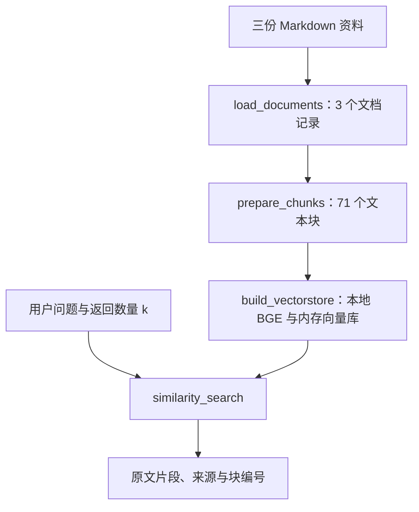

# 开发历史（按日期倒序）

本文件保留开发过程的原始记录。当前项目说明见 [README](../README.md)。历史章节中的 `.\.venv\Scripts\python.exe` 均指 `day05-basic-rag` 的环境，保留原文不改。

# Evidence RAG（建设中）

首次查看可从[独立复现](#独立复现)进入安装、建索引、问答及HTTP演示。[固定15题问答对照](../evals/generation_subset_comparison.md)保存当前效果、成本与失败记录，下文按学习阶段保留实现历史。

## T2评估收尾（2026-11-14）

固定21篇资料、498块，切分配置为500/100。本轮准备35题，包含20道开发题、10道留出题、5道资料不足题，完成三路检索对照和固定15题的完整问答对照。代码与标注由助手辅助实现和审校，实际检索、问答运行由用户操作。

- [开发20题检索对照](../evals/dev20_full_comparison.md)记录Dense、BM25、Hybrid的Hit@3、MRR@3和全部必需依据组覆盖。
- [留出10题检索对照](../evals/holdout10_full_comparison.md)同时保存初始冻结v2与事后补标v3口径，原始报告及冻结题卡可追溯。
- [固定15题问答对照](../evals/generation_subset_comparison.md)记录关闭/开启一次补充的状态、调用、Token和耗时，两轮状态符合均为14/15，调用24/31次，Token为24493/37106。H010补后答出，H001出现检查误拒。

状态符合按实际终态与题卡预期比较。4份已答样本另有助手内容复核记录，其余已答样本的语义复核仍待。用量缺失及请求异常分支已做隔离离线检查，新机器完整安装复现仍待验证。

在已准备依赖、固定语料、模型缓存和索引的仓库环境中，可按以下入口复现。第一条执行本地检索，第二条展示固定问答题卡。第二条追加`--run`会实际请求模型，追加`--recover`会开启一次候选补充。资料不足组将`--split`改为`insufficient`。

```powershell
.\.venv\Scripts\python.exe -X utf8 .\eval_retrieval.py --cases .\evals\rag_cases_full.json --split holdout --corpus full --strategy hybrid --candidate-k 6 --k 3 --all-cases
.\.venv\Scripts\python.exe -X utf8 .\eval_rag.py --cases .\evals\rag_generation_cases.json --split holdout --strategy hybrid --candidate-k 6 --k 3
```

## T1第二步：POST /ask接回完整问答（正常与资料不足已有真实结果）

用户已实际通过/ask提交元数据问题，响应answered，检查1次/回答1次、未补充，引用C076，原文为C076/C075/C241；助手对照响应正文确认答案三项有依据。见evals/api_observations.json。正常回答与下述不足停止已有实测，补后成功回答/上游模型异常的真实HTTP路径仍待，不将两个业务案例当作T1全部完成。

随后CPU型号问题的真实/ask响应为insufficient、answer=null、supplemented=true、检查2次/回答0次、6块原文。说明已有一次补充/不足停止分支已接到HTTP并实际运行；C164的faiss-cpu和C063的device=cpu不是具体电脑型号。上游异常仍仅隔离检查，T1整体学习/配套验收继续按PROGRESS断点，不将停止计作模型或网络错误。

api.py新增/ask，JSON仅包含question。服务端固定Hybrid候选6/初始3并允许一次候选补充，直接复用build_hybrid_candidates和run_checked_rag，不另写检查/回答算法。启动时恢复原文及向量库，问答请求不重算文档向量；BM25仍沿用已有最小构建逻辑。该路由会消耗配置账号模型额度。

在学习工作区的同一终端先Ctrl+C停止旧服务，指定此前配置文件再启动：

```powershell
$env:RAG_ENV_FILE = (Resolve-Path .\day05-basic-rag\.env).Path
.\day05-basic-rag\.venv\Scripts\python.exe -m uvicorn api:app --app-dir .\projects\evidence-rag --host 127.0.0.1 --port 8001
```

独立仓库默认用仓库根目录.env，也可通过RAG_ENV_FILE指定本机文件；路径只在后端配置，HTTP不接收env_file。刷新/docs后，用requests/ask_metadata.json测试。answered返回答案/引用及最终原文；insufficient返回answer=null、模型理由和调用次数，属于已完成资料检查的业务结果。配置文件缺失为503，检索失败500，模型超时504，模型服务或输出校验失败502，非法请求422；异常响应不暴露原始服务错误体，不冒充资料不足。

当前用户已实际验证/retrieve的元数据问题、k从3改1、k=0校验失败，以及/ask正常回答和补后仍不足停止。HTTP 500/502/503/504等异常映射只由真实FastAPI TestClient+假向量库/假问答流程离线检查，未故意发真实模型故障请求，不声称这些异常路径全部完成端到端实测。T1整体学习/配套任务尚未整体验收。

仓库独立运行时，在已按下文准备好RAG依赖、模型缓存和full.json索引后，安装requirements-api.txt，在本机.env或RAG_ENV_FILE中配置模型，再从仓库根目录运行：

```powershell
.\.venv\Scripts\python.exe -m pip install -r requirements-api.txt
.\.venv\Scripts\python.exe -m uvicorn api:app --host 127.0.0.1 --port 8001
```

访问/docs，用requests/ask_metadata.json检查正常回答、requests/ask_insufficient.json检查资料不足。前者通常两次模型调用，后者在既有案例中为两次检查/零次回答，以实际结果为准。evals/api_observations.json是根据用户在聊天提供的HTTP输出整理的观察记录；当前API只返回响应，尚不自动生成每次HTTP请求的完整报告或token/耗时统计。新机器从零复现仍待验证。

## T1第一步：HTTP检索预览（已有用户真实结果）

用户已在Day5环境安装FastAPI0.162.2/Uvicorn0.54.0（Starlette1.10.0），反馈启动完成。首次Swagger占位问题string返回C346/C203/C338；替换元数据问题后实际返回C076/C368/C075、returned=3及对应完整原文。C076直接支持问题，不能把所有候选当作正确依据。记录见evals/api_observations.json。此前另有真实FastAPI TestClient+假库的离线200/422/生命周期检查，未用它冒充持久索引HTTP实跑。

GET /health与POST /retrieve为第一小步。启动生命周期沿用create_embeddings/InMemoryVectorStore.load，一次载入artifacts/indexes/full.json，每个进程内请求复用；同步路由调用已有Dense查询。/retrieve仅返回原文、来源和编号，不执行检查/回答；完整问答另走上文/ask。题目非空/k为1～10的整数，不符合请求格式由框架返回422；缺索引或空索引在启动时失败。

学习工作区D:\tt\agent中，用户为现有Day5虚拟环境安装FastAPI/Uvicorn后启动：

```powershell
.\day05-basic-rag\.venv\Scripts\python.exe -m pip install fastapi==0.162.2 uvicorn==0.54.0
.\day05-basic-rag\.venv\Scripts\python.exe -m uvicorn api:app --app-dir .\projects\evidence-rag --host 127.0.0.1 --port 8001
```

浏览http://127.0.0.1:8001/docs，用POST /retrieve发送requests/retrieve_metadata.json中的内容，返回原文，不请求生成模型。requirements-api.txt用于包含RAG依赖的后续独立环境安装，新机器完整安装尚未验证。第一步真实检索和参数修改/校验结果已记录，完整问答验证和代码带读继续按断点推进，不将此步当T1已完成。

## 11/9 内容复核记录与汇总（已有用户运行）

用户已实际运行Q002展示及复核保存、Q002/Q012汇总，以及离线漏答副本的保存和汇总。复核文件method=manual_labels、reviewer=assistant，表示当前聊天助手带读给出的结论，不是独立人类标注或程序自动判分。summarize_reviews.py按原报告摘要和题号配对最新复核，分别统计已复核/待复核/无答案。完整观察与文件链接见[复核实验记录](../evals/review_observations.md)。

`review_rag.py`读取已有运行报告，把同一题的参考要点、实际答案和所引用块的完整正文放在一起。默认只展示，不调用模型、不修改原始报告。显式`--record`并提供`--answer-complete yes/no`、`--citations-supported yes/no`、`--reason`后，另存至`evals/reviews/`。`--reviewer user/assistant`注明复核者，默认user；这只是来源声明，不是独立复核认证。

记录包含两项外部输入的判断、理由、原报告摘要标识和题卡/运行快照，避免复核结论错配到另一份答卷。当前复核入口只处理已生成答案的结果；统计入口对停止/异常结果显示实际状态，不计答案内容评分。原始报告里的review空值保持不变，结论另存reviews。复核与统计函数已通过隔离离线检查，上述具体路径另有用户实际运行证据，不扩大为自动语义评分、正式题组成绩或全错误路径实测。

在本项目仓库根目录、已有虚拟环境中，默认只展示对照材料：

```powershell
.\.venv\Scripts\python.exe -X utf8 review_rag.py --report evals/results/rag_runs_dev_20261108T123039223518Z.json --case-id Q002
```

确认结论后可用`--record --answer-complete yes --citations-supported yes --reason "填写复核理由" --reviewer user`另存。参数是复核者给出的判断，不是让脚本自动检查内容。汇总已保存的记录：

```powershell
.\.venv\Scripts\python.exe -X utf8 summarize_reviews.py --report evals/results/rag_runs_dev_20261108T123039223518Z.json
```

汇总目前只打印终端，不新增统计文件。缺少复核记录时列为待复核；显式False才计为该项不通过。重复复核仅取同一原始报告/题号中时间最新的一次。

答卷、复核记录与实验JSON按原始字节保留，`.gitattributes`禁止Git自动转换这些文件的换行。复核配对使用文件SHA-256，格式化或改换行后也会成为不同答卷，应保留原文件并另存修改副本。

## 11/8 逐题运行记录与三条路径验证

新增`eval_rag.py`，复用已有检查/一次补充/回答流程，保存预期行为对照、实际答案/原文/引用、调用尝试数及耗时。3张起步题卡分别由用户实际运行：Q002直接回答（检查1/回答1，5.74秒）、Q012补后回答（2/1，12.94秒）、N001补后仍不足停止（2/0，7.94秒）。每题耗时不含模型/索引准备。完整报告链接与口径见[三题运行记录](../evals/rag_seed_observations.md)。

三题均为已有开发或不足控制例，早期报告的token_usage为null。“预期行为符合”比较最终回答/停止状态，答案内容和引用语义由复核者对照原文判断。当前35题卡及检索对照见[20题开发组](../evals/dev20_full_comparison.md)和[10题留出组](../evals/holdout10_full_comparison.md)。2026-11-14新增响应Token用量采集，离线检查通过，用户随后运行Q016验证正常路径，真实输入2050、输出94、合计2144 Token。

## 11/7 正式索引接入检查和回答入口

正式索引Hybrid的Q012预览及恢复回答已由用户实际完成。两路各6且无重复，共12块，融合前6为C368/C353/C306/C097/C138/C002，初始3块C368/C353/C306。随后--check --recover --answer实际首轮False，将当前资料扩为已有6块后复查True，摘录C002“利用同样的嵌入模型将问题向量化”原句并通过存在性核对，生成同模型编码回答且引用C002，编号核对通过，助手对照原文支持答案。该次检查2次、回答1次、补充1次，补充使用保留候选。记录见evals/persisted_hybrid_observations.json，限本开发案例。

check_evidence.py增加--index读取已有索引。恢复库后，用get_by_ids取出同一索引的原文/metadata供Hybrid的BM25使用，沿用保存时的块编号，再接已有资料检查、摘录核对、一次补充和引用回答。模型配置复用create_embeddings。省略--index时，使用原三篇资料构建的旧命令继续有效。

第一步从学习工作区D:\tt\agent预览元数据问题的检索原文和检查请求。

```powershell
.\day05-basic-rag\.venv\Scripts\python.exe -X utf8 .\projects\evidence-rag\check_evidence.py --index .\projects\evidence-rag\artifacts\indexes\full.json --question "文档加载器除了提取正文，还会抽取哪些信息作为元数据？" --candidate-k 6 --k 3
```

11/7用户实际预览成功，恢复21个来源/498块，候选C076/C368/C075/C241/C119/C240，当前3块C076/C368/C075。同配置--check实际判断True，摘录C076原句并通过本地核对；随后用户--check --answer新运行首次检查True，第二次请求生成“文档来源、页码、作者”等元数据回答并引用C076，编号核对通过，助手对照原文支持内容。完整回答这次1次检查+1次回答，未进入补充。记录见evals/persisted_rag_observations.json。新接入AST及5项合成文本/假向量隔离检查通过，覆盖旧默认预览、持久Dense/Hybrid预览、补充后回答衔接、缺索引停止。

同日CPU型号控制例实际运行--strategy hybrid --check --recover --answer，初始C380/C164/C381判断False，补入C063/C020/C254后仍False，程序停止；两轮evidence均为空，检查2次、回答0次。助手对照6块正文，faiss-cpu和device=cpu只提供软件/执行设备说明，当前片段缺少演示机器的CPU完整型号。记录见evals/persisted_hybrid_observations.json。本轮正常回答、补后足够回答、补后仍不足停止均有开发案例输出，完整分组评估接后续阶段。

## 11/6 索引保存第一步

build_index.py复用现有加载、切分和CPU向量构建，默认选择full资料，将向量/正文/metadata保存到artifacts/indexes/full.json。可用--corpus baseline准备旧资料，或--output指定输出文件。保存先写同目录临时文件再替换目标，失败时保留已有目标。

在学习工作区D:\tt\agent执行首次构建。

```powershell
.\day05-basic-rag\.venv\Scripts\python.exe -X utf8 .\projects\evidence-rag\build_index.py --corpus full
```

11/6用户首次真实构建成功，21篇/498块保存到artifacts/indexes/full.json。助手只读核对文件含498条记录、21个来源、498个唯一块编号，每条含id/vector/text/metadata，向量512维；文件约8.15MB，Git忽略已生效。实际配置和文件摘要见evals/index_persistence_observations.json。

加载查询入口query_index.py使用InMemoryVectorStore.load恢复数据，再按问题检索。构建和查询共用retrieve.py中的create_embeddings配置，问题向量在查询时计算。11/6用户独立启动查询实际恢复498条，Q012/k3返回C368/C306/C138，与此前重新构建后的Dense排名一致；查询后索引SHA256与构建时相同。已走通真实保存与加载查询，Q012原有漏检保留。用户随后真实指定missing.json，程序打印找不到文件及构建/路径提示，在模型准备和文件加载前停止；记录见evals/index_persistence_observations.json。

```powershell
.\day05-basic-rag\.venv\Scripts\python.exe -X utf8 .\projects\evidence-rag\query_index.py --question "在线提问时，问题应该用与资料相同的嵌入模型编码，还是可以随意换一个？" --k 3
```

--index可指定已有索引路径，默认artifacts/indexes/full.json。资料新增/修改、切分大小/重叠或嵌入模型/编码配置变化后，通过build_index.py重新构建对应文件；每次提问或调整返回块数k，可加载原索引。当前由使用者按构建配置管理重建，实际构建配置记录在观察报告中。

## 11/4 正式资料准备

固定上游版本的21篇Markdown已放入`data/documents-full/`，逐文件Git blob核对通过，来源见`reference/corpus21_manifest.json`。原三篇及旧清单保留。资料选择已接入加载、切分、Dense、BM25及评估入口；独立检查/Hybrid入口仍默认原三篇。

在学习工作区`D:\tt\agent`观察正式资料的加载与切分。

```powershell
.\day05-basic-rag\.venv\Scripts\python.exe -X utf8 .\projects\evidence-rag\inspect_chunks.py --corpus full
```

2026-11-04用户实际运行确认21篇共498块；原三篇仍分别21/32/18块，前3块来自01_RAG_intro.md，编号在本次资料内重新生成。详见`evals/corpus21_observations.json`。`inspect_documents.py --corpus full`可只看完整文档；两个入口省略参数均使用原三篇。当前仅验证加载和切分。

同一入口新增可选原句定位，用户已实际验证相同原句由旧C056变为full的C130，来源仍为06_vector_embedding.md。这是位置核对，检索效果由单独运行验证。

```powershell
.\day05-basic-rag\.venv\Scripts\python.exe -X utf8 .\projects\evidence-rag\inspect_chunks.py --corpus full --find-quote "Embedding 模型将用户的问题也转换为一个向量"
```

原Dense流程检索正式资料，默认baseline兼容旧命令。11/4用户真实运行Q012/k3得到C368/C306/C138，已知直接依据C130未入前三；返回内容为参考文献、温度配置、对比学习，未直接支持同嵌入模型要求。流程已运行，本例发生漏检，不据此断定全部新资料或Dense均无效。记录见evals/corpus21_observations.json。

```powershell
.\day05-basic-rag\.venv\Scripts\python.exe -X utf8 .\projects\evidence-rag\retrieve.py --corpus full --question "在线提问时，问题应该用与资料相同的嵌入模型编码，还是可以随意换一个？" --k 3
```

同语料、问题、切分和k，用原BM25作单例对照。11/4用户真实运行返回C353/C097/C002，第三块01_RAG_intro.md/C002明确写“检索模块利用同样的嵌入模型将问题向量化”，支持本题答案。C130未返回，但有新增的有效依据；正式资料评估需补充这条来源/原句，旧三篇标注与报告保留。单题不能推断整体最优策略，尚未生成答案或自动运行正式资料题集评估，详情见evals/corpus21_observations.json。

```powershell
.\day05-basic-rag\.venv\Scripts\python.exe -X utf8 .\projects\evidence-rag\bm25_retrieve.py --corpus full --question "在线提问时，问题应该用与资料相同的嵌入模型编码，还是可以随意换一个？" --k 3
```

旧15题依据的位置核对已接入原评估脚本，复用来源文件名与原句包含规则。该模式逐题扫描所选资料的全部块，保存匹配块编号、来源、完整正文和题目快照。11/4用户真实运行15/15题均至少一条旧标注可定位，Q012/Q014对应C130，Q001对应C101/C102/C103；报告为evals/results/evidence_locations_full_20261104T104431025638Z.json。新增来源的有效依据还需在正式评估标注中补充。

```powershell
.\day05-basic-rag\.venv\Scripts\python.exe -X utf8 .\projects\evidence-rag\eval_retrieval.py --corpus full --locate-evidence --all-cases
```

输出“标注依据可定位题数”只表示旧标注能在全体块中定位。运行会打印逐题对应编号并保存带时间戳的`evidence_locations_full_*.json`，用于后续评估准备。

## 此前进展

目标：围绕一组相关资料，逐步完成带原文引用、混合检索、有限检索反馈及实际评估的问答系统。当前从 all-in-rag 选例持续迭代，已验证多文件加载与切分，尚不是完整 RAG 成品。

2026-11-03新增Q012混合候选补充对照实际证据。同题、每路6/保留6/初用3，关闭补充时一次检查False后停止。开启补充时首次False，改用六块后以C056的“使用同一个Embedding模型”原句为依据转True。候选/初始编号一致，人工对照原文支持本例复查判断，额外一次检查请求，两次实验均停在资料检查阶段。详情见`evals/hybrid_recovery_comparison.json`。已知开发案例的单次对照，P001语义误拒仍保留，用量/耗时与其它问题效果待评估。

2026-11-01正常问答路径新增实际证据：元数据问题Dense k3返回C002/C001/C045，检查True并摘录C002，随后真实生成“文档来源、页码、作者”等回答且引用C002；原句/编号核对通过，人工核对内容有支持。记录见`evals/cited_answer_observations.json`。仅本例正常路径验收，不表示P001误拒已解决、整体准确率达标或自动恢复已实现。

2026-11-01最新验证：附原文摘录的三题资料检查已实际运行，P001判断不足但人工核对有依据（误判），P002元数据判断足够合理，P003 CPU型号判断不足合理。编号/原句核对与报告保存已验证，检查语义可靠性尚未解决。详见[三题人工核对](../evals/evidence_review3_notes.md)。下方旧阶段状态为过程记录，以实际报告和本摘要为准。

## 当前范围

2026-11-03资料缺信息控制例已实际运行。CPU完整型号问题Hybrid每路6/保留6/初用3，首次False、补入六块后仍False，程序结束，两次检查且无答案生成。两轮evidence均空，显示核对通过仅表示无条目违反摘录存在性约束，需对照原文判断缺信息。结果追加至`evals/hybrid_recovery_comparison.json`，与Q012补后资料足够案例并列保留。

2026-11-02混合候选预览已由用户实际运行：两路各6，合并12条去重11块，RRF完整排序以共同命中C027为首；保留池C027/C030/C052/C022/C029/C051，当前3块C027/C030/C052，请求只包含当前3块，C027直接依据已进入初始上下文。未调用检查或回答模型，未运行Hybrid自动恢复，不据此宣称模型误拒已修复或整体质量提升。原始编号及配置见`evals/recovery_observations.json`中的`hybrid_preview_run`。

2026-11-02混合候选接入第一小段（真实运行待验证）：新增`--strategy hybrid`，复用`hybrid_retrieve.py`已有去重/RRF/排序函数；每路取`--candidate-k`块，融合后最多保留同样数量作为候选池，再取前`--k`块作为初始资料。每路窗口与候选池上限在此最小入口绑定同一个参数，含义与预算分别打印；合并去重可能产生超过6块，不等于都进入保留池。后续沿现有一次补充/停止路径，不修改检查提示或结果。默认dense及旧命令保留。

先只预览，不调用检查/回答模型：

```powershell
.\day05-basic-rag\.venv\Scripts\python.exe -X utf8 .\projects\evidence-rag\check_evidence.py --strategy hybrid --candidate-k 6 --k 3
```

2026-11-02最小候选补充分支已有三条真实路径：①首次足够跳过补充（元数据问题，6候选/3当前）；②不足补一次，复查仍不足停止（重叠问题，第二次仍有语义误拒）；③候选和当前均3块，判不足后提示无更多原文，不重复请求，停止。记录见`evals/recovery_observations.json`。这些验证运行和上限，不代表语义恢复有效；Hybrid衔接、恢复后正确回答和更大评估尚待完成。

2026-11-02用户已实际运行`--candidate-k 6 --k 3 --check --recover`：首次3块判False，自动使用全部6候选，复查仍False，随后停止；没有重新检索或生成答案。原句核对通过，第二次却误拒C027明确的连续性目的。`evals/recovery_observations.json`保留两轮原结果：一次补充及停止已验证，语义判断可靠性未修复，不把该结果称正确恢复答案。

2026-11-02候选保留预览已由用户验证：候选C030/C022/C051/C037/C035/C027，当前资料C030/C022/C051，请求只包含前三块。记录见`evals/recovery_observations.json`。随后新增显式`--recover`（需`--check`）：首次正常不足且有更多候选时补入其余原文、最多复查一次；首次足够不补、没有更多候选不重复、仍不足结束、异常不混成不足。当前只离线验证，新补充分支真实运行待用户反馈，不能称修复P001。

2026-11-02候选恢复第一小段（待用户运行）：`check_evidence.py`增加`--candidate-k`，先保留完整候选列表`candidate_docs`，再取前`--k`块作为当前检查的`retrieved_docs`。不指定候选数量时沿用原行为（与k相同）；当前尚未在False分支自动补充资料。

仅预览候选与当前资料，在`D:\tt\agent`执行，不请求检查/回答模型：

```powershell
.\day05-basic-rag\.venv\Scripts\python.exe -X utf8 .\projects\evidence-rag\check_evidence.py --candidate-k 6 --k 3
```

- 已写：三份原教程资料的目录加载、文档列表汇总、来源和正文预览、空目录报错。
- 已验证：Python AST、资料 blob 一致性；2026-10-24 用户实际运行加载入口成功，共 3 份文档，正文分别为 7787、11303、6010 字符。
- 已验证：2026-10-24 用户运行 chunk_size=500/chunk_overlap=100 的切分入口成功，3 文档共 71 块；数据加载 21 块、文本切分 32 块、向量嵌入 18 块。前 3 块为 C001/C002/C003，来源均为第一篇，长度为 317/226/453 字符。
- 已验证：2026-10-24 用户运行 BGE 本地缓存模型/内存向量库的 Dense 检索，3 文档/71 块，重叠问题的 Top-3 为 C030、C022、C051，来源均是文本切分教程。流程成功不等于证据充分，人工核对详见 evals/baseline_observations.json。
- 后续计划：可核对引用、Hybrid、小评估、有预算的检索反馈。未完成项不作为现有能力或指标。
- Day 9 已验证：用户已安装 jieba 0.42.1 / rank-bm25 0.2.2，并实际运行中文问题分词。原问题按空格拆为1项，中文分词/清理后为6项：文本、切分、为什么、要、设置、重叠。
- Day 9 已验证：BM25索引/Top-3与同一意图换问法实验，两个问法均由第2名C029提供重叠作用依据；结果与局限见下节，不推广为整体检索提升。
- Day 10 两路候选与合并入口已由用户运行验证：Dense C030/C022/C051，BM25 C052/C029/C020，6条按编号去重后仍6块。重复编号路径仅人工语料离线检查；融合排序尚未实现，不称完整混合检索已完成。
- Day 10 用户已实际运行等权RRF评分/排序：每路3、最终3，完整排名C030/C052/C022/C029/C051/C020，最终未保留直接依据C029。它与C022同分，按首次出现顺序排第4。流程跑通但本例证据覆盖相对BM25前三退化，不能声称融合提升质量。
- Day 10 扩大候选实验已有用户运行：每路6/最终3，12条去重为11块，共同命中C027（两路均第6），累计0.03030303后升融合第1，最终C027/C030/C052含直接解释。仅确认此例恢复依据，默认仍每路3，未测整体质量/延迟。

## 资料检查第一段：请求预览（2026-11-01，用户运行已验证）

新增`check_evidence.py`，复用当前三份资料、切分/编号和Dense检索，把当次问题、返回块的完整正文/来源/编号以及检查要求整理成文字。此阶段未调用生成模型，没有资料充分性判断结果；不读取评估题目的参考回答或标注依据。后续再接模型判断及返回格式校验。

在`D:\tt\agent`执行：

```powershell
.\day05-basic-rag\.venv\Scripts\python.exe -X utf8 .\projects\evidence-rag\check_evidence.py
```

用户实际看到C030/C022/C051和完整检查请求；已按相同数据流带读。请求预览与后续模型检查的证据区分，理解反馈不代表独立实现。

### 资料检查第二段：显式调用模型（同题k3/k6对照已实际验证）

用户实际运行同题模型检查：Dense k3返回C030/C022/C051，判断False；仅增加`--k 6`后，原文新增C037/C035/C027，判断True，理由明确指出C027的重叠保持上下文连续性。对照原文，两次判断均合理，说明本例补进直接依据后检查结果变化，不证明k6总优于k3或所有返回块都相关。两次均走通调用/格式校验，是手动参数实验，尚未接自动恢复/答案生成。

记录见`evals/evidence_check_observations.json`（用户终端输出整理，非API原始响应，未记录用量/耗时/具体模型ID）。格式错误/超时等只有隔离假客户端边界检查，真实故障实验未做；不把两次判断当整体准确率。

`--check`将准备好的文字发给当前DeepSeek兼容服务，JSON输出模式配合Pydantic严格检查两个字段：`sufficient`须为布尔值、`reason`须为非空文字，拒绝缺字段、多余字段和错误类型。调用失败、输出截断/空白、格式错误均为检查失败，不当作资料足够，也不混为正常的资料不足判断；格式合法不保证判断正确。

沿用本机Day 5配置，无需复制密钥或重装依赖。在`D:\tt\agent`执行：

```powershell
.\day05-basic-rag\.venv\Scripts\python.exe -X utf8 .\projects\evidence-rag\check_evidence.py --check --env-file .\day05-basic-rag\.env
```

此命令请求真实模型并消耗额度。独立工程也可按`.env.example`填写自己的`.env`，届时不需要`--env-file`。当前只沿用已验证供应商调用形式，其他供应商的JSON模式/非思考参数需另核对。`requirements-check.txt`记录现有版本，尚未验证新机器安装。JSON输出参数核对[DeepSeek官方文档](https://api-docs.deepseek.com/guides/json_mode/)，空内容及截断仍需检查。

## 当前已验证的数据流

可回查检查结果的三题开发回归入口已准备（`review_evidence_checks.py`，真实运行待验证）。复用一次Dense索引，分别检查重叠目的k6、元数据问题k3、资料未说明的CPU完整型号k3；原句与理由由人工核对，不把三题当独立测试。默认仅列题，显式命令最多三次模型判断，不生成答案、不自动重试。每题保存原文/请求/模型结构化结果和原句核对状态到`evals/results/evidence_review3_UTC时间.json`；检查异常单独记录，不改成False。

```powershell
.\day05-basic-rag\.venv\Scripts\python.exe -X utf8 .\projects\evidence-rag\review_evidence_checks.py --check --env-file .\day05-basic-rag\.env
```

2026-11-01下一阶段为检查结果增加`evidence`原文摘录列表（尚未真实验证）：每项为`chunk_id/quote`；先找相关原句再作判断，False也可列出部分相关原句及缺口。True必须有摘录；Python核对编号在本次返回块中、quote逐字存在于该编号正文。原句存在性通过不保证语义判断正确，验证失败为检查结果不可用，不自动改成True/False。旧两字段真实记录保留原版本，不冒充新格式验证；下一步先带读，再用有依据/不足等小组问题作开发回归。

最新复跑：检查v2在相同显示问题/六块/规则下又返回False，回答v2没有执行。保留前一次True和本次假阴性，当前修复不可靠。暂停围绕单题的提示修改/重复调用；后续先设计可回查依据与多案例回归，不将此例称成功修复，也不假定摘录校验能证明语义正确。

2026-11-01最新真实结果：检查标准v2对同题k6判断True，成功进入回答并完成第二次请求；回答却引用C027的重叠作用同时称没有依据，人工判错误拒答。编号检查通过不代表答案合格。已保存原回答全文，回答提示仅澄清通用的目的/效果忠实概括与引用一致性；实际修复、资料不足回归和其他题评估待验证。执行链跑通与答案质量分开记录，不将当前答案记作成功问答。

2026-11-01真实`--k 6 --check --answer`运行遇到检查假阴性：C027明确重叠保持上下文连续性，模型却认为未解释目的并返回False；程序按不足分支正常停止，未调用回答生成。此前同题k6=True及本次False均保留于观察JSON。仅澄清通用检查标准（用途/效果与问题要求、忠实概括），未更改k/模型参数或绕过检查。规则修复、k3回归及正向生成/引用仍待真实验证，不能称回答链已跑通。

2026-11-01新增检查通过后的引用回答路径（未由用户实际运行）：显式`--check --answer`时先检查；False提示不足并结束，True才用同一问题和完整原文另发回答请求。检查和回答共用`request_model_text`客户端，默认预览、原`--check`仅检查的行为保留。回答检查`[C数字]`编号是否来自本次原文，内容支撑仍需人工复核；无引用会明确提示。

在`D:\tt\agent`中运行以下命令：通过检查时共两次模型调用；不足时仅一次。此阶段未接自动补救。

```powershell
.\day05-basic-rag\.venv\Scripts\python.exe -X utf8 .\projects\evidence-rag\check_evidence.py --k 6 --check --answer --env-file .\day05-basic-rag\.env
```

2026-11-01下一小段新增资料检查结果分支（仅静态检查，用户运行待验证）：`sufficient=False`显示当前资料不足并`return`，`True`走到回答入口提示；当前尚未调用回答生成或自动补救。原k3/k6真实报告来自新增分支前，不当作本段分支已运行证据。



每个节点均对应当前代码和用户运行记录。后续生成回答、混合检索与反馈流程分别验证后再加入图中；内存索引当前每次重建。模块设计与效果取舍通过实际问题对照记录，不只展示技术名词。

## 成品目标与验收（计划，尚未实现）

- 一组相关文档覆盖术语、跨片段/跨文档与无答案问题，结果能追溯文件和块；三篇教程只是起步。
- 在同一组问题上对比 Dense、BM25、Hybrid，保留命中/遗漏和实际测量，不预设混合检索必然提升。
- 回答附原文引用、资料不足明确说明；程序编号检查与内容支撑评估区分。
- 选取一条有界反馈：资料质检不足时改写再检索，有重试上限与耗尽后的不足/失败结果，并保留与无反馈基线的对照。
- 先约 15～20 个有预期依据的回归问题，覆盖正常/漏检/无答案，记录检索、引用、延迟与失败；这只是初始样本，不声称普遍准确率。
- 索引构建与问答职责清楚，可复用或按文档重建；有接口/可复现入口、配置示例、日志、README 和自己的改动说明。

### 自我反思的具体范围（计划，尚未实现）

本轮所说的自我反思，是一个受控的检索检查与修正流程：检索 → 判断资料是否相关/充分 → 不足时改写问题再检索 → 达到次数上限仍不足时明确说明。不能只增加“反思”提示词就视为该模块完成。

验收需保留同组问题下有/无反馈的实际对照，记录改善、未改善或退化、增加的耗时/模型调用和停止路径；同时能够结合代码解释、修改和排错，区分参考代码与自己的改动。当前三篇资料加载是第一阶段，反馈流程、混合检索、完整评估和工程交付均待完成。

## 今天运行

复用当前学习机器已有的 Day 5 环境，不需重新安装：

```powershell
cd D:\tt\agent
.\day05-basic-rag\.venv\Scripts\python.exe -X utf8 .\projects\evidence-rag\inspect_documents.py
```

预期加载 3 份文档，显示数据加载、文本切分和向量嵌入各自的文件名、正文长度、前 100 字符。实际运行是否成功，以用户输出为准。此入口不读密钥、不加载模型权重、不发模型请求。

第二阶段切分观察，由用户执行：

```powershell
cd D:\tt\agent
.\day05-basic-rag\.venv\Scripts\python.exe -X utf8 .\projects\evidence-rag\inspect_chunks.py
```

预期仍有 3 份完整文档，生成多个文本块，并显示各文件块数和前 3 块的编号/来源。具体块数以实际运行输出为准；500/100 是本项目实验基线，不声称优于旧示例或是最优参数。块编号仅对应当前语料和切分配置，资料或参数变化后需重新核对。

## 第三阶段：向量检索（用户运行已验证）

复用当前已有模型缓存和环境：

```powershell
cd D:\tt\agent
.\day05-basic-rag\.venv\Scripts\python.exe -X utf8 .\projects\evidence-rag\retrieve.py
```

默认问题“文本切分为什么要设置重叠？”，--k 默认 3；两个参数都可以在命令末尾更换。预期从 71 块中返回最多 3 个带编号和来源的原文片段，具体排序/能否提供依据以用户实际输出为准。问题和文本块均由嵌入模型编码；返回的结果为正文与 metadata，不是向量。

此入口在本机计算嵌入，使用内存索引，退出后不持久保存；每次运行重建。它不读取密钥、不调用生成模型，也不把相似度排名当成答案正确性评估。

### 第一个真实基线观察

问题“文本切分为什么要设置重叠？”的 Top-3 命中了相关文件，但完整 C030/C022/C051 主要是示例代码/边界问题、模型长度限制和句子窗口，未直接取回原文“通过重叠机制保持上下文连续性”的说明。记录为部分相关、直接证据覆盖不足，不能视为完全无关或整体检索评估通过。

原始配置、用户返回编号与人工判断见 [baseline_observations.json](../evals/baseline_observations.json)。2026-10-24 用户保持其他条件不变运行 --k=6，返回 C030/C022/C051/C037/C035/C027；人工只读核对 C027 完整正文，发现其中确有重叠保持上下文连续性的直接说明，该句位于前 300 字符预览之后。

本例扩大返回范围补回了依据，但依据仍排第 6，前三名未改变，不能视作排序改善。返回原文合计从 1145 增至 2384 字符，未测延迟或生成 token；不将一个例子推广为普遍改进。默认 k=3 保留作基线，本次只通过命令参数设为 6。

```powershell
cd D:\tt\agent
.\day05-basic-rag\.venv\Scripts\python.exe -X utf8 .\projects\evidence-rag\retrieve.py --k 6
```

## Day 9 第一阶段：中文分词（用户运行已验证）

为后续关键词匹配准备一致的词项列表。初版只比较按空格拆分与中文分词；当前 bm25_retrieve.py 默认已扩展为检索，若只回看分词请加 --inspect-only。原71块、Dense默认k及已有基线记录不变。

在已有学习环境增加 rank-bm25（评分工具）和 jieba（中文分词工具），不新建环境，也不下载 BGE/生成模型：

```powershell
cd D:\tt\agent
.\day05-basic-rag\.venv\Scripts\python.exe -m pip install -r .\projects\evidence-rag\requirements-bm25.txt
.\day05-basic-rag\.venv\Scripts\python.exe -X utf8 .\projects\evidence-rag\bm25_retrieve.py --inspect-only
```

预期看到原问题、按空格拆分列表与中文词列表，实际切词以用户运行输出为准；此阶段没有BM25排名，不把切词成功等同检索改善。问题/文本块后续会使用同一个 tokenize 函数，返回检索结果仍是原文块。

已有 AST、模拟切词清理逻辑检查，以及上述用户真实安装/分词输出。完整BM25检索的实际证据见下节，分词成功本身不等于检索效果已验证。

## Day 9 第二阶段：BM25 检索（用户运行已验证）

```powershell
cd D:\tt\agent
.\day05-basic-rag\.venv\Scripts\python.exe -X utf8 .\projects\evidence-rag\bm25_retrieve.py
```

from_documents 接收71个Document并保留正文/metadata，调用 tokenize 处理各块正文建立词统计；invoke接收原始问题，内部再按同一规则处理，返回默认3个Document。主程序提前打印问题词列表用于观察，不将该列表当作invoke的输入。

为方便核对证据，BM25入口展示返回块的完整正文。2026-10-27用户在同三份资料、71块、500/100、原问题、k=3下实际返回C052/C029/C020（427/243/437字符）。C029的代码注释明确说明块间重叠“以缓解语义割裂”，所以本例前三块取回了直接依据；C052主要是工具介绍，C020主要是PDF解析，仍混有未直接回答问题的结果。

同一问题的Dense前三块未直接覆盖重叠作用，BM25此次取回了另一块C029中的依据；这不是将Dense第6名C027提升到前三，也不能推出BM25在其他问题上更好。返回正文共1107字符，未测查询耗时、生成token或整体准确率，未调用生成模型。配置与人工判断见 [bm25_observations.json](../evals/bm25_observations.json)。

只将问题改为“chunk_overlap 有什么作用？”后，用户实际得到C034/C029/C036，C029仍排第2；三块都含参数用法，不等于三块都解释作用。实际问题词为chunk/overlap/有/什么/作用，jieba会拆开标识符，当前预处理不保证保留整个参数名。保持资料/问题规则一致，本次未改变分词行为。

即使问题词没有匹配，该库的get_top_n也可能返回k条零分候选；当前不把返回条数或排名当充分依据，需原文核对。该限制由独立模拟语料验证，不作为课程案例效果结论。

## Day 10：两路候选与合并去重

用户已实际运行两路候选入口并核对完整原文，结果见 [hybrid_observations.json](../evals/hybrid_observations.json)。当前新增合并去重阶段，仍不输出融合排名或调用生成模型。沿用当前已安装依赖与嵌入缓存，无需重新安装。

```powershell
cd D:\tt\agent
.\day05-basic-rag\.venv\Scripts\python.exe -X utf8 .\projects\evidence-rag\hybrid_retrieve.py
```

--candidate-k默认3，控制每路各返回几块。两路使用同一批带编号Document，结果分别保存到dense_docs/bm25_docs。merge_candidates按metadata.chunk_id去重，完整Document放进merged_docs，编号另存seen_ids检查重复；首次出现顺序不是融合排名。用户实际运行合并段得到6→6，编号顺序为C030/C022/C051/C052/C029/C020；本次没有重复候选，重复路径仅用独立人工语料检查。两路仍分开保留，供后续使用各自排名进行融合。

等权RRF评分与排序已由用户实际运行：分数由两路原始排名累计，降序排序；同分使用Python稳定排序保留合并时的首次出现顺序，即本基线Dense优先。--k默认3控制最终块数，候选不足时返回实际可用数量。所有最终结果仍是含正文与metadata的Document，不是分数或编号列表。

基线每路3个候选无共同编号，RRF同名次同分，C029与C022均0.01612903，固定同分顺序将直接依据C029排到第4。最终C030/C052/C022共1330正文字符，没有直接解释重叠作用；不能视为融合效果提升。详细用户运行记录见evals/hybrid_observations.json。后续仅扩大每路候选至6、最终仍3的真实实验见下节，未为保留已知答案私改分数或同分规则。

### 候选数对照（用户实际运行）

| 每路候选数 | 最终块数 | 去重 | 最终编号 | 直接依据 |
| --- | --- | --- | --- | --- |
| 3 | 3 | 6→6 | C030/C052/C022 | 未保留 |
| 6 | 3 | 12→11 | C027/C030/C052 | C027说明重叠保持上下文连续性 |

第二次仅扩大每路候选、最终仍3，其他问题/语料/配置/融合规则不变。C027在两路均第6，分数1/66+1/66≈0.03030303；正文仅保留一份，两路贡献均计入，最终排第1。最终正文1337字符，C029仍未入选，恢复依据来自C027。单例不证明一般效果、参数最优或三个最终块都相关；没有测延迟/生成token，默认每路3保留作失败基线。原始输出见 [候选6实验日志](../evals/runs/2026-10-28-candidate6-k3.txt)。

```powershell
.\day05-basic-rag\.venv\Scripts\python.exe -X utf8 .\projects\evidence-rag\hybrid_retrieve.py --candidate-k 6 --k 3
```

## Day 11：评估题读取与核对函数

evals/retrieval_cases.json最初为3道开发题，现为15道（原3题不变）；数据加载、文本分块、向量嵌入各5题。初版17条quote确认原文存在后，实际检索又发现Q010漏标有效原文，现dev15-v2补两条共19条。仍是开发标注，不保证穷尽或属于独立测试；下面3题表格均历史结果，15题初版11/15及标注修订见末节，不能跨题组/标注版本混算。

```powershell
cd D:\tt\agent
.\day05-basic-rag\.venv\Scripts\python.exe -X utf8 .\projects\evidence-rag\eval_retrieval.py --inspect-only
```

读取段已由用户实际运行，显示3题、Q001三条依据与Q002/Q003各一条；预设参考回答不是模型实际回答。has_labeled_evidence检查返回块来源文件名与标注source一致，正文包含任意一条quote则True，否则False，已有人工输入隔离检查。Q001 k3返回C030/C022/C051、结果False；仅改k6后新增C037/C035/C027，C027来源/正文包含标注依据，结果True，两次均与人工核对一致。记录见evals/retrieval_observations.json；没有3题整体指标，标注短语命中仍需人工复核。

```powershell
.\day05-basic-rag\.venv\Scripts\python.exe -X utf8 .\projects\evidence-rag\eval_retrieval.py --k 3
```

检索仍使用本机已缓存嵌入模型/现有依赖，无新下载或生成模型请求。--inspect-only只读题；--k控制第一题Dense返回数量，不是题目数量。

同一第一题的k6对照命令：

```powershell
.\day05-basic-rag\.venv\Scripts\python.exe -X utf8 .\projects\evidence-rag\eval_retrieval.py --k 6
```

本例扩大返回范围使单题标注命中False→True，直接依据仍第6，未改善排序。True只表示至少一块命中，不表示所有返回块都相关或回答正确；默认仍k3。当前未评估Q002/Q003或多策略，不称整套评估完成。

### 三题Dense检查（用户运行已验证）

```powershell
.\day05-basic-rag\.venv\Scripts\python.exe -X utf8 .\projects\evidence-rag\eval_retrieval.py --all-cases --k 3
```

索引只构建一次，逐题复用。--all-cases选择文件中的全部题目，--k控制每题返回块数；默认不加--all-cases仍只查第一题。每题命中任一备选依据，hit_count仅加1；输出为标注依据命中题数，不是所有返回块的相关比例或生成回答准确率。

2026-10-30用户实际运行Dense k3：Q001返回C030/C022/C051，False；Q002返回C002/C001/C045，True（C002支持）；Q003返回C055/C041/C040，True（C055支持）。命中2/3，与报告内完整正文人工核对一致，仅限这3题开发集与当前配置。报告见 [三题Dense k3结果](../evals/results/dense_k3_20261030T073406489663Z.json)。BM25同题对照见下节，Hybrid尚未接入评估。

执行检索后会在evals/results/保存带UTC时间戳的JSON报告，包含配置、实际题目/标注快照、命中数和每题返回的完整原文/来源/编号，便于人工复核；仅--inspect-only不建索引或保存检索报告。时间戳用于区分记录，尚未测查询延迟。上述真实报告只覆盖Dense，新增BM25分支状态见下节，Hybrid未接入评估。

### 同题BM25对照（用户运行已验证）

```powershell
.\day05-basic-rag\.venv\Scripts\python.exe -X utf8 .\projects\evidence-rag\eval_retrieval.py --all-cases --strategy bm25 --k 3
```

只替换检索方式，题目/标注/每题返回3块/核对与计数规则保持一致。BM25使用既有tokenize和BM25Retriever，在题目循环前建一次索引，不加载嵌入或生成模型。默认--strategy dense，旧命令行为保留；BM25报告以bm25_k3_时间戳.json保存。Hybrid尚未接入评估入口。

2026-10-30用户实际BM25 k3为3/3：Q001 C052/C029/C020（C029支持），Q002 C002/C001/C011（C002支持），Q003 C055/C056/C063（C055支持）。已只读 [BM25实际报告](../evals/results/bm25_k3_20261030T075950324028Z.json)核对全文，并确认与Dense的题目/标注快照、切分配置和k相同；差异在Q001。3题小开发集不能证明总体优劣或用于宣称通用100%准确率。

### 同题Hybrid对照（每路3/6、最终3均用户运行已验证）

```powershell
.\day05-basic-rag\.venv\Scripts\python.exe -X utf8 .\projects\evidence-rag\eval_retrieval.py --all-cases --strategy hybrid --candidate-k 3 --k 3
```

Hybrid复用Day10的merge_candidates/calculate_rrf_scores/rank_candidates，共用一次切分，循环前准备两路索引，逐题合并/去重/等权RRF排序后只核对最终k块。常数60、同分保持首次出现顺序（Dense先），沿用原规则；--candidate-k控制每路候选，--k控制最终返回数。报告hybrid_c3_k3_时间戳.json记录每路候选编号、去重数、各块分数/完整排名及最终原文，方便分析融合丢失依据。

2026-10-30每路3/最终3用户实际为2/3：Q001 C030/C052/C022 False（C029同分后第4），Q002 C002/C001/C045 True（C002），Q003 C055/C041/C056 True（C055）。匹配原文与已人工核对的BM25报告一致，题目/标注/最终k相同。报告见 [Hybrid每路3结果](../evals/results/hybrid_c3_k3_20261030T081433113319Z.json)。当前三题Dense2/3、BM253/3、Hybrid每路3为2/3；候选6/最终3为下一对照，不预填结果。

每路6/最终3随后实际为3/3：Q001 C027/C030/C052（C027支持），Q002 C002/C001/C009（C002支持），Q003 C055/C064/C041（C055支持）；完整原文已核对。Q001共同C027两路各第6、总分2/66≈0.03030303，升第一进入最终块。报告见 [Hybrid每路6结果](../evals/results/hybrid_c6_k3_20261030T081903365021Z.json)。

| 当前3题开发集配置 | Q001 | Q002 | Q003 | 标注依据命中题数 |
| --- | --- | --- | --- | --- |
| Dense最终3 | 未命中 | 命中 | 命中 | 2/3 |
| BM25最终3 | 命中 | 命中 | 命中 | 3/3 |
| Hybrid每路3/最终3 | 未命中 | 命中 | 命中 | 2/3 |
| Hybrid每路6/最终3 | 命中 | 命中 | 命中 | 3/3 |

四组题目和标注快照相同，最终均3块，但Hybrid候选预算更大；这3题仅验证开发评估流程与已知失败，不证明一般优胜、最优参数或生成准确率。默认策略/候选数不据单例调整；新15题开发集已准备，实际检索评估尚待用户运行，见下节。

### 15题开发集扩展（题目已准备，检索待用户运行）

只扩题目和原文依据，评估代码/原资料/切分/匹配规则保持不变。保留Q001～Q003，新增Q004～Q015覆盖加载阶段、文档处理库、文件路由/MIME参数、超长输入截断、语义/递归分块、句子窗口、同模型编码、向量距离、离线索引及一词多义。新问法包含概念描述与技术词；仍是基于已知资料的开发集，不能当作独立测试或保证平衡无偏。

初版15题/17条备选引用已只读确认原文存在，三份资料各5题；用户后续已实际运行Dense，原始结果11/15。--all-cases现在选择15题，旧3题结论保留在其报告中，不能与15题总数混算。当前标注修订为dev15-v2，需先重新运行Dense，再用相同标注比较其他策略：

```powershell
.\day05-basic-rag\.venv\Scripts\python.exe -X utf8 .\projects\evidence-rag\eval_retrieval.py --all-cases --strategy dense --k 3
```

逐题命中检查仍是来源与原文短语匹配，检索失败时需区分真的漏检与标注不完整/跨块截断；如发现标注问题，应记录修订并让各方法在同版标注上重测，不为提高某策略分数临时改规则。每次报告保存完整题目/依据快照及返回原文，历史实验不覆盖。

### 15题首轮与标注修订

Dense k3初版实际11/15，False为Q001/Q010/Q012/Q014，原报告 [dense v1原始结果](../evals/results/dense_k3_20261030T083717420943Z.json)不改写。人工检查发现Q010返回C033已明确“递归分块会继续使用更细粒度的分隔符（句子→单词→字符）直到满足大小要求”，C032也说明有剩余分隔符时递归继续分割；原标注只认另一段表述，所以是标注遗漏造成的假阴性，不能直接记为检索失败。

已将原题组保存 [dev15-v1标注快照](../evals/retrieval_cases_dev15_v1.json)，当前dev15-v2仅给Q010补上述两条等价依据，问题/原参考回答/其他14题/匹配规则均不改。19条quote均确认原文存在，修订原因和原始成绩记录在retrieval_observations.json。

用户重跑Dense k3后实际12/15，报告 [dev15-v2 Dense基线](../evals/results/dense_k3_20261030T084503794456Z.json)。新旧15题检索设置及每题返回完整原文完全相同，只有Q010由False变True（C033/C032支持），剩余未命中Q001/Q012/Q014；11→12来自标注修订，不是检索改善。后续BM25/Hybrid必须使用同版v2，不能与历史3题成绩混算。

BM25 k3随后用户实际15/15，报告 [dev15-v2 BM25结果](../evals/results/bm25_k3_20261030T085052364880Z.json)。已确认两次题目/标注快照与最终k、语料和切分配置一致；BM25补回Q001（C029）、Q012和Q014（均C056），C056全文明确同模型编码及离线索引构建阶段。

| 当前15题dev15-v2配置 | 标注依据命中题数 | 状态 |
| --- | --- | --- |
| Dense最终3 | 12/15 | 用户实际运行、报告核对 |
| BM25最终3 | 15/15 | 用户实际运行、报告核对 |
| Hybrid每路3/最终3 | 13/15 | 用户实际运行、报告核对 |
| Hybrid每路6/最终3 | 14/15 | 用户实际运行、报告核对 |

四组均已保持相同v2题目/标注及最终3块，完整表格、逐题结果、失败归因和报告链接见 [15题对照总结](../evals/dev15_comparison.md)。Hybrid每路3漏Q001/Q012，每路6仅漏Q012：Q012的支持块C056已在BM25候选第2，却在融合后排第5；共同但未直接支持问题的C023因两路第3名贡献相加升第一。增加候选并没有解决所有排序问题，未为追求满分改权重或同分规则。

这里的15/15仍只属于已知资料上的开发题，不能作为独立测试成绩或宣称通用100%准确率；Hybrid每路6的候选预算更大，尚未测延迟或生成质量。

## 完整问答评估起步（三题已有实际记录）

`evals/rag_cases.json`先保存已有的两道开发例与一道资料不足控制题，20开发/10冻结/5不足的正式题组尚待扩充。参考事实与依据留在评估层，运行问答时只传入问题和实际检索原文。

`eval_rag.py`默认展示题卡，显式`--run`请求模型。复用`check_evidence.py`的`run_checked_rag`，保存检查结果、补充路径、答案、引用编号、调用尝试数和逐题耗时。每题结束保存，错误单独记录，已完成题目保留。

2026-11-14新增Token采集。共用请求函数从收到的响应中读取prompt_tokens、completion_tokens、total_tokens，每次调用追加到本题run.model_usage。评估层将各次用量汇总到token_usage，记录attempted_calls、responses_received和complete。缺响应或缺字段时，合计为null、complete为false，已有逐次记录仍保存在model_usage中。已收到但正文/格式校验失败的响应，其用量在校验前记录。该改动通过隔离假客户端和网络拦截检查。

用户实际Q016运行的两次响应分别为1135/72/1207和915/22/937，汇总输入2050、输出94、合计2144，complete为true。检查1次、回答1次，耗时约5.10秒，答案两类输入齐备并引用C002。[真实运行报告](../evals/results/rag_runs_dev_20261114T083021278972Z.json) 缺用量或调用失败等分支目前为离线验证。

仓库根目录、已有环境下运行一道开发题的示例：

```powershell
.\.venv\Scripts\python.exe -X utf8 eval_rag.py --case-id Q002 --run --recover --env-file .env
```

学习工作区对应使用`day05-basic-rag`的解释器和配置路径。输出的“预期行为符合”只比较应回答/应提示不足，不能当作答案准确率。答案完整性、说法支撑和引用支撑仍为待复核字段。当前已有静态检查、9条隔离流程检查及批量入口的失败后继续/报告保存检查；用户另行实际运行的3道起步题记录见上文，不扩大为正式题组或新环境验证。

## 独立复现

### 准备环境与模型缓存

仓库克隆到任意目录后，在仓库根目录使用Python 3.13创建环境。以下版本来自现有学习环境，新机器完整安装仍待验证。

```powershell
python -m venv .venv
.\.venv\Scripts\python.exe -m pip install torch==2.14.1 --index-url https://download.pytorch.org/whl/cpu
.\.venv\Scripts\python.exe -m pip install -r requirements-api.txt
.\.venv\Scripts\python.exe -c "from sentence_transformers import SentenceTransformer; SentenceTransformer('BAAI/bge-small-zh-v1.5', device='cpu')"
```

requirements-api.txt通过已有依赖文件包含加载、切分、嵌入、BM25、模型客户端与API依赖。首次模型缓存准备会下载权重，后续create_embeddings使用本地缓存。首次配置时复制.env.example为.env，填写LLM_API_KEY、LLM_BASE_URL、LLM_MODEL_ID。默认客户端沿用已验证的DeepSeek兼容请求参数，其他供应商按实际支持情况核对。

### 构建正式资料索引

data/documents-full中的21篇Markdown随仓库保存，固定版本和逐文件摘要见reference/corpus21_manifest.json。索引在本机构建，默认路径为artifacts/indexes/full.json。

```powershell
.\.venv\Scripts\python.exe -X utf8 .\inspect_chunks.py --corpus full
.\.venv\Scripts\python.exe -X utf8 .\build_index.py --corpus full
```

当前固定配置为500/100，用户实际运行结果为21篇、498块，full.json保存498条向量、原文及metadata。已有索引在资料、切分和嵌入配置相同时可继续加载。

### 三种问答分支演示

以下从仓库根目录执行，三个命令均会实际请求模型。共用full.json、Hybrid每路6候选、初次3块及一次补充，使用本机.env。表格记录已有用户运行路径，检查模型的实际判断可能波动，每次以本次输出为准。

| 问题 | 已有实际路径 | 检查/回答调用 | 原始证据 |
| --- | --- | --- | --- |
| 加载器抽取哪些元数据 | 初次足够并回答 | 1/1 | [Q002报告](../evals/results/rag_runs_dev_20261108T123039223518Z.json) |
| 问题是否使用同一嵌入模型 | 补充后足够并回答 | 2/1 | [Q012报告](../evals/results/rag_runs_dev_20261108T144525508118Z.json) |
| 演示电脑CPU完整型号 | 补充后仍不足，结束 | 2/0 | [N001报告](../evals/results/rag_runs_insufficient_20261108T145440776132Z.json) |

```powershell
.\.venv\Scripts\python.exe -X utf8 .\check_evidence.py --index .\artifacts\indexes\full.json --strategy hybrid --candidate-k 6 --k 3 --check --recover --answer --question "文档加载器除了提取正文，还会抽取哪些信息作为元数据？"
.\.venv\Scripts\python.exe -X utf8 .\check_evidence.py --index .\artifacts\indexes\full.json --strategy hybrid --candidate-k 6 --k 3 --check --recover --answer --question "在线提问时，问题应该用与资料相同的嵌入模型编码，还是可以随意换一个？"
.\.venv\Scripts\python.exe -X utf8 .\check_evidence.py --index .\artifacts\indexes\full.json --strategy hybrid --candidate-k 6 --k 3 --check --recover --answer --question "这些教程的演示实验使用的电脑CPU完整型号是什么？"
```

### HTTP与评估入口

```powershell
.\.venv\Scripts\python.exe -m uvicorn api:app --host 127.0.0.1 --port 8001
```

访问http://127.0.0.1:8001/docs，/retrieve返回检索原文，/ask执行完整问答。requests/ask_metadata.json和requests/ask_insufficient.json提供请求样例。现有HTTP实测覆盖正常回答及补后不足，补后成功回答的HTTP路径待验证。两项目同机运行时分别选择端口。

批量评估入口与结果见本页T2小节，以及[开发组检索对照](../evals/dev20_full_comparison.md)、[留出组检索对照](../evals/holdout10_full_comparison.md)和[固定问答对照](../evals/generation_subset_comparison.md)。源码、数据和参数可按以上说明准备，三条CLI分支已有用户运行证据，新机器全流程复现仍待验证。

## 来源与局限

固定参考、原版与适配差异、许可声明和资料路径见 [SOURCES.md](../SOURCES.md)。引用代码及原文资料保留上游署名与许可，不把参考实现或上游评测成绩写作自己的成果。

加载成功只说明文件能被读入，不等于切分、检索、生成或回答质量已验证。后续每个模块分别记录代码完成、用户运行和实际评估。

## 仓库状态

用户选择先私有维护，远程仓库为 [na-jeamin/evidence-rag](https://github.com/na-jeamin/evidence-rag)。首版范围是已由用户运行验证的多文件加载。学习计划、个人复盘和课程大纲不属于本项目提交范围。
